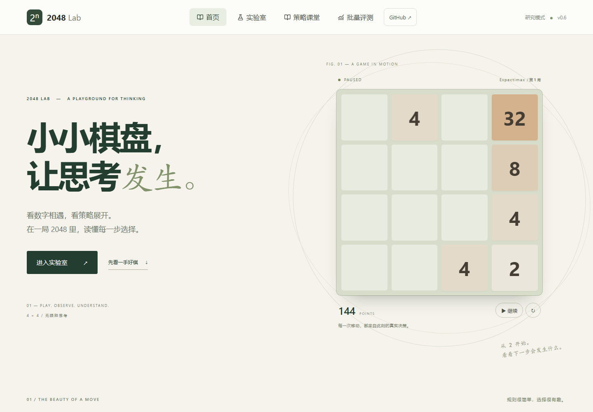
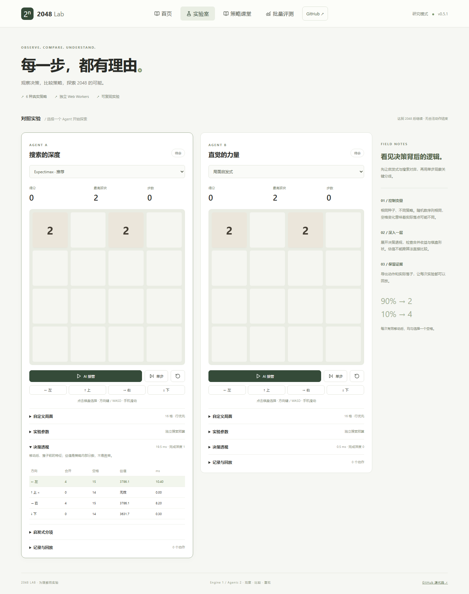

# 2048 Lab 使用手册

2048 的规则可以很快学会，但一手棋为什么值得走，常常需要多看几眼。本手册从合并规则开始，带你手动操作、让六种算法接手，再用决策解释、回放和批量实验理解它们的选择。



## 目录

1. [规则：一手棋如何发生](#规则一手棋如何发生)
2. [开始操作与对照实验](#开始操作与对照实验)
3. [六种自动策略](#六种自动策略)
4. [启发式如何评价棋盘](#启发式如何评价棋盘)
5. [Expectimax 如何看向未来](#expectimax-如何看向未来)
6. [读懂决策与策略课堂](#读懂决策与策略课堂)
7. [一个可以亲自复核的对照](#一个可以亲自复核的对照)
8. [保存、回放与分叉](#保存回放与分叉)
9. [批量评测与可复现实验](#批量评测与可复现实验)
10. [常见问题](#常见问题)

## 规则：一手棋如何发生

棋盘有 4 × 4 个格子。新局随机放置两块数字砖；每次向左、上、右、下滑动时，所有砖块向该方向靠拢，相邻同值砖块两两合并。

以下是**向左滑动、尚未生成新块**时的单行例子，0 表示空格：

| 移动前 | 移动后 | 本步增加分数 | 观察重点 |
|---|---|---:|---|
| 0, 2, 0, 2 | 4, 0, 0, 0 | 4 | 先挤掉空格，再判断相邻数字 |
| 2, 2, 2, 2 | 4, 4, 0, 0 | 8 | 从移动方向依次配对 |
| 2, 2, 4, 0 | 4, 4, 0, 0 | 4 | 新合成的 4 本步不能再次合成 8 |
| 4, 4, 8, 8 | 8, 16, 0, 0 | 24 | 得分增加合并后数字的总和 |
| 2, 4, 8, 16 | 2, 4, 8, 16 | 0 | 棋盘未改变，这是无效动作 |

每个有效动作完成后，在当前空格中**等概率选择一个位置**放置新块：90% 为 2，10% 为 4。无效动作既不生成新块，也不消耗环境随机数。

本项目采用研究模式：合出 2048 后继续游戏，直到四个方向都无法改变棋盘。满盘仍可能有合法合并；判断终局需要检查相邻同值块，而不只是检查空格。

## 开始操作与对照实验

首页会自动运行一局真实棋局。观看移动、合并与新块出现，可以暂停、继续或重开；在策略章节点击一行，会让演示切换为该组的代表策略。页面离开视野或切换到后台时，演示暂停计算，返回后继续。

进入**实验室**后有 Agent A、Agent B 两块棋盘：

1. 点击棋盘所在的实验区，选中要操作的 Agent。
2. 用方向键 / WASD、方向按钮或手机滑动手动移动。
3. 选择策略，点击 **AI 接管**自动运行，或用**单步**观察一次决策。
4. 暂停后可继续手动走棋；重置会根据当前环境种子开始新局。
5. 展开**实验参数**，调整预算、Expectimax 最大深度或 Rollout 长度。修改环境种子后需重置生效。
6. 展开**自定义局面**，输入按行排列的 16 个数字；0 为空格，其余值须为 2 的幂。应用后创建新记录，分数归零。

两块棋盘可以使用不同策略。初始环境种子相同，方便从同一起点比较；随着动作不同，棋盘结构和具体落点也会不同。

完整舒缓动画固定为 360 ms 位移，加上合并回弹与新块出现。AI 决策等待固定 500 ms，并等待前一步动画完成。**播放节奏与搜索预算是两件事**：增加预算改变算法能探索的范围，而不是动画速度。暂停时已经接受的一步会落定；重置会取消进行中的旧动作。



## 六种自动策略

每种策略都先排除无效方向，再从合法候选中选择。除随机策略外，估值相同的方向按左、上、右、下顺序取第一个。

| 策略 | 实际选择依据 | 适合观察什么 | 主要局限 |
|---|---|---|---|
| 随机合法动作 | 为每个合法方向生成一个独立随机签号，选择最大签号 | 建立随机基线，观察合法性过滤 | 不评价合并与棋盘结构 |
| 固定方向优先 | 左 → 上 → 右 → 下，第一个合法方向 | 简单规则如何塑造棋盘 | 不考虑局面变化带来的价值 |
| 即时合并贪心 | 最大化本次合并得分 | 眼前得分与后续空间的冲突 | 看不到新块及后续动作 |
| 局面启发式 | 本步合并分 + 移动后棋盘的 H | 空格、平滑、单调、角落等结构偏好 | 权重是人工设计的，局部高分不保证长期表现 |
| 有限预算 Expectimax | 玩家节点取最大值，落子节点按概率求期望 | 随机环境中的前瞻决策 | 深度与节点预算限制搜索范围，叶子仍依赖 H |
| Monte Carlo rollout | 对每个候选做多次随机模拟，比较累计合并分 + 末局 H 的均值 | 抽样波动与模拟长度的影响 | 随机后续策略会带来偏差，样本有限；它不是 MCTS |

随机策略与 rollout 使用算法自己的随机数序列，不能读取环境种子或未来落子。

Rollout 的预算按合法根动作分配。设合法方向数为 m，预算为 B，配置长度为 L：

- 每个方向额度：q = max(1, floor(B / m))。
- 实际模拟长度：l = min(L, q)。
- 模拟次数：N = max(1, floor(q / l))。

每次从该方向移动后的棋盘出发，模拟落子与随机合法移动，累计合并分；末端加 H，遇终局使用 -10,000,000 的终局项。平均这些结果得到该方向估值。增加 L 可能减少 N，因此“模拟更长”与“样本更多”之间存在权衡。

## 启发式如何评价棋盘

H 评价棋盘结构，而游戏总分记录已经发生的合并收益。二者单位与用途不同。

```text
H = 270 × 空格数
  +   3 × 平滑项
  +  15 × 平方单调项
  +   5 × 角落项
  + 100 × 可合并对数
```

计算时用 log2(数字) 表示砖块大小，空格记为 0：

| 分项 | 代码中的含义 | 倾向 |
|---|---|---|
| 空格数 | 值为 0 的格子数量 | 留出行动空间 |
| 平滑项 | 每行、列跳过空格后，相邻非空 log2 值差的绝对值之和取负 | 相邻数字大小更接近 |
| 平方单调项 | 每行、列保留空格，对相邻 log2 值的平方分别累计正向和反向差，再取较小累计量的负值 | 数字沿一个方向较有序 |
| 角落项 | 最大砖在任一角落时取其 log2 值的平方，否则为 0 | 最大砖留在角落；多个角落不会重复奖励 |
| 可合并对数 | 每行、列跳过空格后，相邻同值非空砖的对数 | 提供后续合并机会 |

启发式策略评估的是**移动后、落子前**的棋盘：

```text
Q(方向) = 本步合并得分 + H(移动后的棋盘)
```

表中的 H 与 Q 应分别阅读。一个方向的 Q 更高，表示它更符合这套评分偏好；Q=785 不表示 78.5% 的胜率。不同策略的估值含义也不同，不宜直接跨策略比较大小。

## Expectimax 如何看向未来

搜索把一次决策拆成两类节点：

- **玩家节点**：尝试合法动作，选择“即时合并分 + 后续价值”最大的动作。
- **随机落子节点**：枚举所有空格及 2/4 两种新块，按真实规则加权求和。

若移动后有 E 个空格，每个位置的 2 分支概率为 0.9/E，4 分支为 0.1/E：

```text
Q(a) = merge(a) + Σ位置 [0.9/E × V(放2后的棋盘)
                     + 0.1/E × V(放4后的棋盘)]
```

达到搜索边界时，用 H 评估仍可继续的局面；终局叶子用 -10,000,000。这个惩罚是算法评分规则的一部分，不会扣减游戏得分。

默认最大深度为 3、节点预算为 6000。深度 1 指根动作之后枚举一次落子，再评估叶子；更深一层会继续探索玩家动作与随机落子。棋盘空格越多，落子分支越多，达到相同深度可能更昂贵。

实现采用逐层加深：只有所有合法根方向都完成同一深度，才提交该层估值。中途耗尽预算，会保留上一完整层，避免把某些深方向与另一些浅方向直接混在一起。若第一层都未完成，明确回退为启发式策略。应同时看**配置最大深度、实际完成深度、预算与耗时**。

## 读懂决策与策略课堂

实验室的**决策透视**列出四个方向：

- 合法性：该动作是否会改变棋盘。
- 合并分：仅本次滑动增加的分数。
- 空格与启发式分项：移动后、实际新块出现前的结构。
- 算法估值：当前选中策略的比较值。
- 耗时：当前设备上实际计算的毫秒数。

总耗时会受到设备、浏览器和运行负载影响。它用于观察计算成本，不是算法结果质量的单独证明。

**策略课堂**包含六课，每课有四个步骤：规则与局面 → 四方向比较 → 决策理由 → 练习与代码。先预测动作，再核对分项；可复制注释代码，也可将当前示例、策略、参数和种子带入 Agent A。

Expectimax 课堂可展开落子的概率、叶子值和加权贡献。Rollout 课堂展示不同算法种子的估值波动，并提供独立教学轨迹；该轨迹用于解释模拟流程，不是上方均值中的某个具体样本。


## 一个可以亲自复核的对照

在课堂选择**分数与空间的冲突**，或把下面的数字粘贴到实验室自定义局面：

```text
0  4  0 16
32 4 32  8
16 16 0  8
4 32  8 16
```

先只比较滑动结果，暂不放新块：

| 方向 | 本步合并分 | 空格 | H | 启发式 Q = 合并分 + H |
|---|---:|---:|---:|---:|
| 左 | 32 | 4 | -656 | -624 |
| 上 | 24 | 5 | 761 | 785 |

贪心优先考虑 32 分；启发式在这两项中更偏好向上，因为结构项补偿了少得的 8 分。完整决策还会比较右、下方向，不能只凭这两行推出所有策略的最终选择。

建议按以下顺序实验：

1. 暂停 AI，把相同局面分别应用到两个 Agent。
2. A 选择贪心，B 选择启发式，比较四方向估值。
3. 分别单步，观察实际新块出现后的棋盘。
4. 再启用自动运行，回放后续关键动作。
5. 用多局评测研究长期表现；一手棋的局部优势不等于整局优势。

## 保存、回放与分叉

展开**记录与回放**可保存到本机，或导出/导入 JSON。

记录包含引擎与算法版本、初始局面/分数/RNG、每步动作、**实际落子位置和值**、实际使用策略、参数、耗时及回退原因。回放按这些动作和落子重建棋盘，而不是重新让策略猜同一步。

用回放进度选择帧，或点击**回放下一步**查看动画。选择某一帧后可**从此处分叉**，继续试另一种策略。当前版本支持逐步回放；自动连续回放在后续计划中。

本机保存依赖当前浏览器存储。需要跨设备或保留长期记录时，导出 JSON。导入文件会核验版本、棋盘值、合法动作和落子位置；格式损坏会显示错误。

## 批量评测与可复现实验

批量评测可选择 20 或 100 局、策略、目标砖和起始种子。后台 Worker 运行实验，界面可继续响应，也可取消。

关注这些指标：

| 指标 | 读法 |
|---|---|
| 样本数 | 实际完成并纳入统计的局数 |
| 平均分 | 所有样本分数之和除以样本数，容易受极端值影响 |
| 中位分数 | 排序后的中间位置，更接近典型局 |
| 目标砖达到率 | 完成样本中最高砖达到指定目标的比例 |
| 平均决策耗时 | 决策计算成本，与设备和负载相关 |
| 停止原因 | 区分正常终局与 20,000 步实验上限截断 |

目标砖达到率应带上目标、样本数、参数和种子范围一起报告，不能当作普遍胜率。达到 2048 后仍继续的规则也会影响最终分数。

复现实验建议保存：引擎/算法版本、策略与参数、起始种子和局数，以及需要检查的 JSON 回放。当前批量页使用内置默认算法参数；实验室修改的参数不会自动传入批量评测。

### 随机数约定

环境使用 uint32 LCG：state = 1664525 × state + 1013904223（mod 2³²）。空格按行优先 0–15 排序。每次生成新块恰好抽两次随机数：先选择空格，再选择 2/4。无效移动不抽随机数。

环境 RNG 与算法 RNG 分开。**相同环境种子意味着相同随机数序列，不意味着不同策略得到相同具体落点**：动作改变空格集合，抽到的序号就可能对应另一个位置。

同一版本、参数和算法种子下，当前节点预算搜索可重复动作选择；实测毫秒数仍会波动。保存真实落子的回放也能跨过未来计时预算或实现变化带来的不确定性。

## 常见问题

**为什么到 512 就结束了？**

512 不是停止门槛。如果棋盘已经满了，而且水平、垂直方向都没有可合并对，四个方向都无效，游戏就结束了。

**为什么按方向键没有新块？**

该方向可能不改变棋盘。确认已选中目标 Agent，处于手动状态，并尝试一个合法方向。

**为什么配置深度 3，显示完成深度 1？**

节点预算只足够完整评估第一层。增大预算可能探索更深，但计算成本也会增长。

**为什么不同算法的估值差那么多？**

随机签号、即时合并分、人工结构分与搜索期望值的含义不同。比较同一算法下的候选动作，跨算法用多局实验观察结果。

**为什么增加 Rollout 长度后表现未必更好？**

固定预算下，长轨迹可能减少样本数；模拟采用随机后续动作，结果本身也有抽样波动。

**Worker 失败怎么办？**

实验室会显示错误，可点击恢复 Worker，或使用明确标记的应急合法动作。首页演示提供重试。回放会记录实际使用的回退策略。

---

实现对应规则引擎 1、算法 agents-2。继续探索可阅读 [规则引擎](src/engine.ts)、[策略实现](src/agents.ts)和[教学例子](src/teaching.ts)。开发和验证方法见 [维护者指南](CONTRIBUTING.md)。
