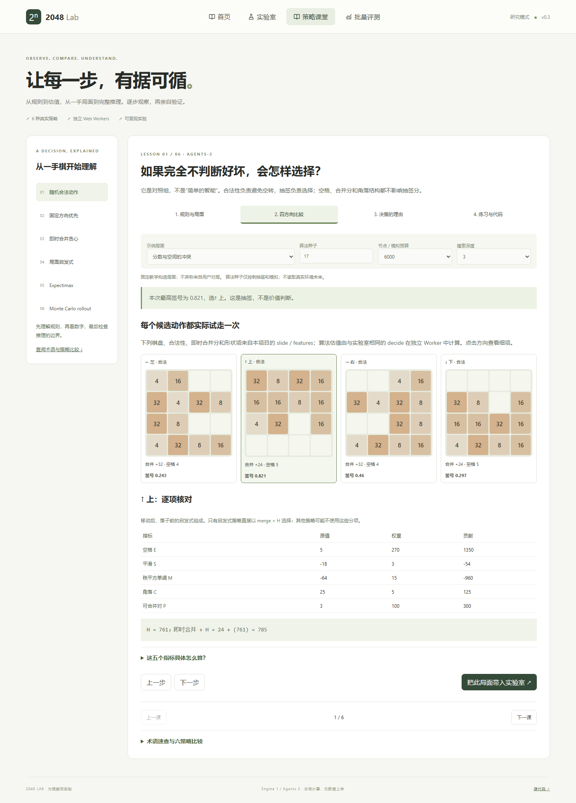

# 2048 Lab

看懂每一步选择：真实 2048 引擎、六种策略、交互课堂和可复现实验。

仓库：[ider-zh/2048-game-lab](https://github.com/ider-zh/2048-game-lab)。产品版本 v0.3；规则引擎 1，算法 agents-2。本版深化教学与产品首页，没有修改 v0.2 算法强度。


## 本地运行

推荐 Node.js 24（已在 24.3.0 验证），最低 22.12。首次安装后启动：

```sh
npm ci
npm run dev -- --port 5178
```

打开 http://127.0.0.1:5178 。Windows 可执行 `Start-Preview.ps1`，隐藏启动本地预览；不依赖云端服务。

```sh
npm run typecheck
npm test
npm run build
npm run preview -- --port 5179
```

## 四个入口

- `/#home`：可滚动产品首页。真实引擎从两块初始砖开始，由 Expectimax Worker 自动推进；可暂停、继续、换策略、改速度、新开局。正常终局显示后使用新种子重开。离屏或页面隐藏暂停，返回继续；减少动态偏好关闭过渡并将每步间隔提高至至少 1.2 秒。首次访问不用点击启动。
- `/#lab`：独立双棋盘；键盘、方向按钮、手机滑动；六种策略、参数、决策解释、自定义局面、保存/导入/导出、回放和分叉。离开实验室暂停 AI，返回保留局面。
- `/#learn`：六课，每课四步：规则与局面 → 四方向比较 → 决策理由 → 练习与代码。可把示例棋盘、算法种子、参数直接带入 Agent A。
- `/#batch`：20/100 局完整对局评测，可取消；均分、中位分、目标砖达到率、平均决策耗时和停止原因。

## 课堂为什么可信

四方向棋盘和合并分直接来自 `slide`，形状指标来自 `features`。课堂估值在独立 Worker 中调用同一 `decide`，不影响游戏算法。用同一示例比较真实签号、方向优先级、即时合并奖励、启发式和搜索估值。

固定冲突示例中，左/右得到 32 分、4 个空格；上/下得到 24 分、5 个空格。启发式左为 -624，上为 785。测试直接核对这些数值。

Expectimax 可以展开每个空位的 2/4 分支，核对概率、叶子值与加权贡献。深度 1 教学展开与实际深度 1 搜索逐方向对照；若实际完成深度更深，界面明确说明浅层表不是其完整解释。

Rollout 展示三个算法种子的真实估值变化，并给出一条明确标注为独立教学样本的轨迹。该轨迹不冒充实际生产平均值中的某一个样本，三次种子变化也不是置信区间。随机策略代码按真实实现讲解：逐个合法方向抽签、取最大值，而非旧课堂中简化的直接索引抽样。



## 六种真实策略

| 策略 | 比较依据 | 主要局限 |
|---|---|---|
| 随机合法 | 每个合法方向一个独立算法 RNG 序列中的签号，最大者获选 | 不判断棋盘价值；不宣称有限种子频率严格均匀 |
| 固定优先 | 左、上、右、下中的第一个合法方向 | 不看结构与未来 |
| 即时贪心 | 本步合并分 | 可能牺牲空间 |
| 启发式 | 合并分 + H | 人工权重，无未来落子搜索 |
| Expectimax | 玩家 max、机会节点加权期望、有限预算迭代加深 | 叶子近似与预算限制，可能输 |
| Monte Carlo rollout | 随机模拟收益加末端 H 的均值 | 有采样噪声、策略偏差；不是 MCTS |

`H = 270×空格 + 3×平滑 + 15×秩平方单调 + 5×角落 + 100×可合并对`。秩是 log2(砖值)，空格为 0。平滑与可合并对先去除行/列空格；单调项保留空格、在秩平方空间计算每行列两个方向损失的较小值的负数。最大砖在任意角落才奖励最大秩平方，不重复计角落。

Expectimax 预算默认 6000、最大深度 3。只有全部合法根动作完成一层才提交，未完成层丢弃；第一层都没完成则明确回退启发式。终局叶子为 -10,000,000（算法惩罚，非规则扣分）。Rollout 默认长度 12，预算均分给根动作；末端位于最后一次模拟移动后、下一块生成前。所有平局按左、上、右、下排序。估值不是胜率，也不应直接跨策略比较。

## 规则、随机数与回放

行优先索引 0–15。初始生成两块，每次有效移动后生成一块；空格均匀选择，2/4 概率为 90%/10%。每块每步最多合并一次，合并后数值计分。达到 2048 后继续，直到没有合法动作。512 不是停止门槛。

环境 RNG 使用 uint32 LCG：`state = 1664525 * state + 1013904223 (mod 2^32)`。每次落子恰好两次抽样：先按升序空位列表选择位置，再选 2/4；无效动作不消耗 RNG。算法只收到棋盘、算法参数与独立算法种子，无法读取环境 RNG 或未来落子。同环境种子不代表不同策略有相同实际落点。

JSON 记录引擎/算法版本、起始棋盘/得分/RNG、种子、每步方向、实际落子、真实所用策略、参数、耗时与回退原因。兼容 agents-1 老回放；逐步/滑条重放和分叉均使用实际落子。课堂送入实验室时环境种子固定为 2048，算法起始种子采用课堂设置。

Worker 异常、无效响应和 15 秒超时均有明确提示。实验室可用合法方向应急推进并恢复 Worker；应急动作记录为 `emergency-legal`。首页演示遇计算失败明确暂停并提供重试。代次标识保护重置和导航，批量取消直接终止 Worker。批量每局 20,000 步上限单独标记截断，不伪装正常终局。

## 测试与证据

`npm test` 包括规则、RNG、策略、防提前终止与教学一致性。2,000 个种子棋盘 × 4 方向，与独立逐格 oracle 对照。实际 Edge 脚本（先启动 5178）：

```sh
node browser-test.mjs
node extra-test.mjs
node stop-regression.mjs
node full-game-test.mjs
node v3-browser-test.mjs
```

证据见 `evidence/`、[HANDOFF](HANDOFF.md)。手机测试是 390px 触摸浏览器模拟，不代表已在实体手机或 Safari 测试。

v0.2 冻结参数后，在独立 seeds 41000–41019 上，启发式均分 6220.4→13170.6；Expectimax 均分 27877.6→44970.4，2048 达到样本数 13/20→19/20，决策耗时约 2.65→12.04 ms。此为默认配置整体升级（预算也增加），并非保证胜率。本版算法未改变。seed 41011 仍真实止于 512、8328 分、591 步，四方向不可动；失败证据保留。

## Cloudflare Pages 静态部署

由仓库所有者自行部署；本项目不包含自动部署流程。

| 设置 | 值 |
|---|---|
| Git 仓库 | `ider-zh/2048-game-lab` |
| 生产分支 | `main` |
| 根目录 | 仓库根目录（留空） |
| 构建命令 | `npm run build` |
| 输出目录 | `dist` |
| Node | 建议 `NODE_VERSION=24`；仓库也提供 `.node-version` |

这些构建设置与 [Cloudflare 官方 React / Pages 文档](https://developers.cloudflare.com/pages/framework-guides/deploy-a-react-site/)一致。依赖通过 lockfile 安装，无服务端、密钥或环境配置需求。

路由使用 URL hash（`/#lab`、`/#learn`、`/#batch`）。服务器始终请求 `/`，所以**不需要 `_redirects` 或服务端路由重写**。Vite 会输出独立 Worker 文件到 `dist/assets`，必须上传整个 `dist`，不能只上传 index.html。开发命令不是部署命令。上线后检查首页自动运行、课堂 Worker 与导航直达。

## 文件结构与边界

- `src/engine.ts`、`agents.ts`、`worker.ts`：规则、六策略、后台评测。
- `src/Landing.tsx`：真实首页演示与离屏生命周期。
- `src/Classroom.tsx`、`teaching.ts`、`teaching.worker.ts`：教学、可核对示例和独立课堂计算。
- `src/main.tsx`：导航与实验室；`research/`：版本比较快照、脚本、逐局结果。

无模型训练、DQN/TD 训练曲线、账号或遥测。尚未实现自动连续回放、评测参数自定义、置信区间。首页为实时数字/色阶变化，不是预录视频，也不假称每次位移都做了逐块动画。

原理参考（独立实现，未复制代码）：[原版](https://github.com/gabrielecirulli/2048)、[搜索](https://github.com/nneonneo/2048-ai)、[N-tuple](https://github.com/mszubert/2048)、[TD](https://github.com/moporgic/TDL2048)、[网页先例](https://nathom.dev/2048/)。


## v0.4 — 真实逐块动画（2026-10-15）

首页、实验室手动/AI/单步和逐步回放共享逐块滑动组件：150 ms 平移、95 ms 合并与新块反馈。引擎提供每个来源格到目标格的轨迹，四个连续相同数字只合并为两块，不重复合并。数值、得分与实际落子记录在落定时一起提交。快速手动输入排队并按最新已提交局面计算；AI 播放间隔与搜索预算仍独立，动画串行。暂停完成已开始的一步后停止，重置/载入/跳转回放会取消旧动画及队列；离开实验页会落定当前步。减少动态效果模式取消平移和缩放，仅短暂描边。

验证：36 项单元/规则/策略/教学/轨迹测试通过；轨迹测试覆盖 500 个局面的四个方向。typecheck、生产构建通过。真实 Edge 专项测试记录了 11 个逐帧样本、7 个不同中间位置；桌面与 390px 手机真实触摸、合并/新块、连续输入、回放中重置、AI 暂停、30 ms 间隔和 reduced-motion 均通过。证据为 evidence/animation-results.json 和 animation-*-mid.png。原有 browser-test.mjs 回归亦通过（六策略、JSON、课堂、20 局评测与取消）。

运行：npm ci；npm run dev -- --port 5178。验证：npm run typecheck；npm test；npm run build；node animation-browser-test.mjs；node browser-test.mjs。截图为实际浏览器采样，不是效果图。仍未做自动连续回放、训练模块或公开部署。


## v0.5 — 看得见的汇合（2026-10-15；替代 v0.4 动画时序）

根因已在用户当前 Chrome 的 5178 页面复现：页面是 v0.4，但真实 matchMedia('(prefers-reduced-motion: reduce)') 为 true；旧组件把滑行时间设为 0，同时全局 CSS 禁用 transition，因而只剩描边闪动。旧 150 ms 完整动画本身也过急，合并与落子同时发生。

现在首次使用仍跟随系统，不修改 OS 设置。页面顶部明确显示当前模式，可选“完整 · 舒缓滑行”“快速 · 紧凑滑行”“减少动态效果”。主动选择会保存在本页 localStorage。已在用户真实 Chrome 中通过可见控件选择完整模式，并确认系统媒体查询仍为 true、滑行 transition 为 0.36s；保留了新的首页预览标签供体验。旧标签刷新后也会读取保存的选择。

完整模式：360 ms 加减速滑行；来源块可追踪地汇合，目标块从 0.92 缩放到 1.075 再回稳，翻倍数字同步出现；合并反馈约 300 ms，新块延迟 160 ms 再用 200 ms 浮现。低值只有轻微局部细环，128 以上增强局部暖色光晕，2048 以上稍加强，均无震屏、粒子或音频。格子底板始终保留，只有数字面层移动和缩放。快速模式为 180 ms 滑行、较短反馈。首页默认决策等待由 260 增至 500 ms；下个动作始终等待当前动画结束，搜索预算不受影响。

验证：38 项单元测试、typecheck、生产构建通过。browser-test.mjs（六策略、回放、课堂、20 局评测、取消）、animation-browser-test.mjs（手机真实滑动、重置、快输入、暂停等）、production-smoke.mjs 与 reduced-motion-test.mjs 均通过。新增 motion-quality-test.mjs 使用可见 Edge、未覆盖系统偏好，先记录该隔离浏览器报告的 false，再通过页面选择完整动画；不能将该结果替代用户 Chrome 的 true。它录制并逐帧检查两来源、2/2/2/2、128+128、1024+1024、无合并移动以及回放、重置、暂停。压缩/回弹和延后落子均被采样验证。另有 reduce=true 的专门测试确认页面主动 opt-in 能生效且不修改系统查询。

核验材料：evidence/motion-v0.5.mp4 为 26.2 秒真实浏览器录屏（489 个捕获帧按实际时间编码）；evidence/merge-sequence.png 为录屏连续帧；evidence/motion-quality-results.json 与 reduced-motion-results.json 为结果。运行质量录像测试需本机 ffmpeg（当前已安装），其他测试不需要。

本轮没有任何远端写入尝试。此前审批阻塞保持不变；未部署。最新源码包为父目录 2048-lab-source-v0.5.zip（包含 dist 和视频）。


## GitHub publication update — 2026-10-15

Publication approval was restored for ider-zh/2048-game-lab. The v0.5 source, test evidence and a read-only GitHub Actions CI workflow are now being submitted to main. CI runs npm ci, typecheck, all unit tests and the production build on Node 24. No Cloudflare settings or deployment are part of this change. Earlier approval-blocker notes below/above are historical; use the current GitHub main commit and Actions result as the publication status.
